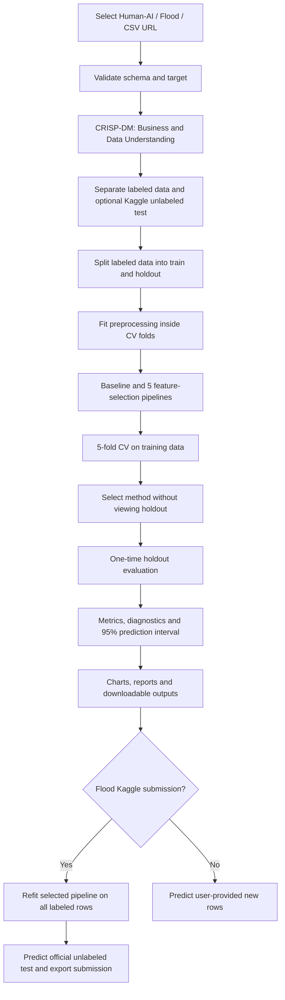

# HW2 Regression Lab — Workflow

## UI navigation
Overview → Business Understanding → Data Understanding → Data Preparation → Modeling → Evaluation → Deployment.

## Reproducibility
Set random_state=42, pin versions, record sample mode and seed, retain model configuration and feature lists with each run. Run unit tests before GitHub push and Streamlit Cloud deployment.
